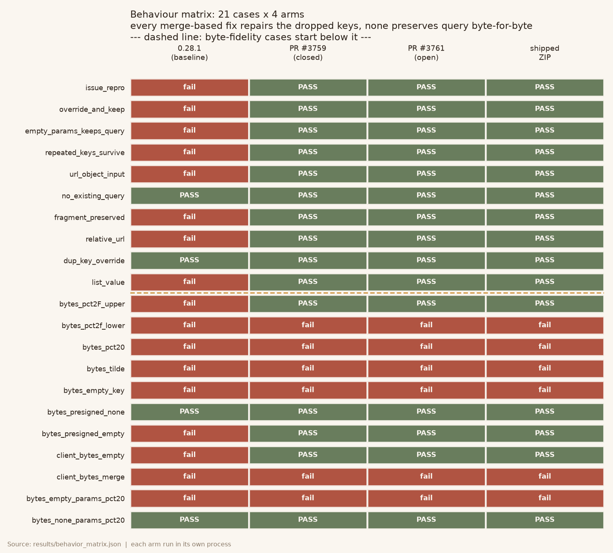
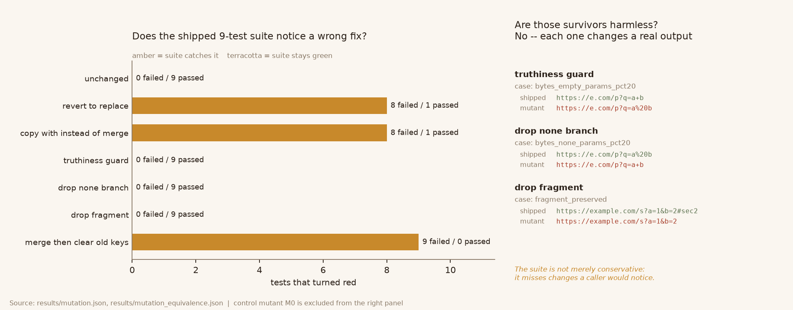
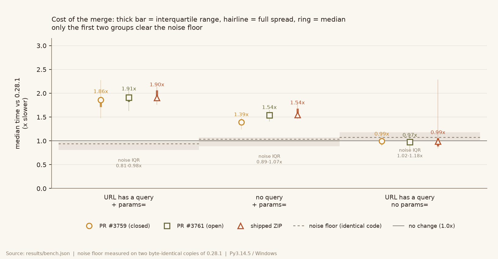

# httpx-query-merge-audit

Independent audit of the ZIP package `httpx-query-merge-patched` (0.28.1+audit1),
which ships a source copy of [HTTPX](https://github.com/encode/httpx) 0.28.1 with one
change: `Request(..., params=...)` merges with the URL's existing query string instead
of replacing it.

**Verdict: the merge itself is correct and matches the upstream pull request, but the
package is not safe to adopt as-is.** Two independent reasons:

1. **It changes the bytes of query strings it touches.** Merge-based fixes rebuild the
   query from parsed key/value pairs, so `%20` becomes `+`, `%2f` becomes `%2F` and `~`
   loses its escape. Signed URLs (AWS SigV4, Azure SAS, Aliyun OSS) break. This is not
   specific to this package — the same is true of upstream PR #3761.
2. **It installs under the distribution name `httpx-query-merge-patched` while writing
   the `httpx/` import package.** Installing real `httpx` afterwards silently takes over
   the code; uninstalling this package afterwards deletes all 23 `httpx` modules and
   leaves the real distribution's metadata orphaned. Both directions are reproducible.



Each column is a separate arm run in its own process: pristine 0.28.1, the closed
PR #3759, the open PR #3761, and the ZIP as shipped. All three fixes repair the reported
bug (15/21 cases pass vs 4/21 for the baseline). None of them is byte-faithful: 5/11
byte-fidelity cases pass, and the 6 failures are identical across all three.

## What was checked

| Check | Script | Result |
|---|---|---|
| Only `_models.py` differs from upstream | `scripts/tree_diff.py` | 25 common files; only `_models.py` differs |
| The shipped `.patch` reproduces the shipped files | `scripts/patch_fidelity.py` | byte-identical for both files |
| 21 behaviour cases x 4 arms | `scripts/probe_matrix.py` | see figure 1 |
| Do the shipped 9 tests catch a wrong fix? | `scripts/mutation_probe.py` | 3/7 mutants caught |
| Are the surviving mutants harmless? | `scripts/mutation_equivalence.py` | no — all 4 change real output |
| Cost vs 0.28.1 | `scripts/bench.py` | ~1.9x slower when a query exists; noise floor 0.81–0.98x |
| Wheel install / coexist / uninstall | `scripts/package_probe.py` | coexistence and removal both break `httpx` |

## The byte-fidelity problem

`URL.copy_merge_params()` goes through `QueryParams`, which stores decoded values. When
the query is re-emitted it is re-encoded canonically. Anything that signed the original
bytes no longer matches:

| Input query | After a merge | Fidelity |
|---|---|---|
| `sig=ab%2Fcd` | `sig=ab%2Fcd` | preserved (uppercase hex only) |
| `sig=ab%2fcd` | `sig=ab%2Fcd` | broken — lowercase hex is normalised |
| `sig=ab%20cd` | `sig=ab+cd` | broken — `%20` becomes `+` |
| `t=%7E` | `t=~` | broken — unreserved chars are decoded |
| `flag` | `flag=` | broken — valueless keys gain `=` |

The escape hatch is real but narrow: when `params is None`, no parsing happens and the
raw query survives byte-for-byte. The moment `params` is anything else — including
`params={}` — the query is rebuilt.

```python
import httpx

signed = "https://b.s3.amazonaws.com/o?sig=ab%20cd&exp=1700000000"

httpx.Request("GET", signed).url                 # unchanged, byte-for-byte
httpx.Request("GET", signed, params={}).url      # sig=ab+cd  <- signature now invalid
httpx.Request("GET", signed, params={"x": "1"})  # sig=ab+cd&x=1
```

If you need both merging *and* signature integrity, do the concatenation yourself on the
raw string instead of letting `Request` re-encode:

```python
url = base if not extra else base + ("&" if "?" in base else "?") + urlencode(extra)
httpx.get(url)  # params=None, so the query is never re-parsed
```

## The packaging problem

`pyproject.toml` declares `name = "httpx-query-merge-patched"` but
`[tool.setuptools.packages.find] include = ["httpx*"]`, so the wheel's `top_level.txt`
is `httpx`. pip's file ownership is per distribution, not per import name, so two
distributions claim the same directory:

```
$ pip install httpx_query_merge_patched-0.28.1+audit1-py3-none-any.whl
$ python -c "import httpx; print(httpx.Request('GET','https://e.com/s?a=1',params={'b':'2'}).url)"
https://e.com/s?a=1&b=2                      # the patch is in effect

$ pip install httpx==0.28.1
$ python -c "import httpx; print(httpx.Request('GET','https://e.com/s?a=1',params={'b':'2'}).url)"
https://e.com/s?b=2                          # the patch is silently gone

$ pip uninstall -y httpx-query-merge-patched
$ python -c "import httpx"
ModuleNotFoundError: No module named 'httpx'  # 23 .py files deleted, httpx-0.28.1.dist-info still present
```

The wheel also drops the `httpx` console script and declares no extras, so
`pip install <wheel>[http2]` warns that the extra does not exist while upstream
`httpx[http2]` pulls in `h2`.



## The tests

The shipped suite is 9 tests in `tests/test_request_params_regression.py`; 8 fail on
pristine 0.28.1, which is genuine evidence for the bug. But it is not evidence that the
fix is *right*: three plausible wrong implementations leave all 9 green.

| Mutant | Suite | Behaviour actually differs? |
|---|---|---|
| revert to `URL(url, params=params)` | 8 red | yes (17 cases) |
| `copy_with(params=...)` instead of merge | 8 red | yes (17 cases) |
| `if not params:` instead of `if params is None:` | all green | yes — `params={}` stops being a no-op |
| drop the `params is None` fast path | all green | yes — presigned URLs get re-encoded |
| merge then clear the fragment | all green | yes — `#frag` is lost |

The last three matter because they are exactly the two risks above: the fast path is what
preserves signatures, and no test asserts byte fidelity or fragment survival.



Performance: with a query present, request construction goes from ~27 µs to ~51 µs, i.e.
~1.9x slower (medians of per-round ratios: 1.86x PR #3759, 1.91x PR #3761, 1.90x shipped;
interquartile ranges 1.71–2.06x). Without a query the ratio is 1.39–1.54x. When the URL
has a query but the caller passes no `params`, all three arms land at 0.97–0.99x with an
IQR of 0.89–1.06x against a noise floor of 1.02–1.18x — indistinguishable from identical
code, so no ratio is claimed there. Absolute times are Python 3.14.5 / Windows only; treat
them as order-of-magnitude.

## Reproducing

```bash
python -m pip install -r requirements.txt

# 1. fetch pristine 0.28.1 the way the audit did (Contents API, real blobs)
python scripts/fetch_upstream.py --out build/upstream --hash-out results/upstream_hashes.json

# 2. unpack the ZIP under audit, then materialise the four arms
python scripts/prepare_arms.py \
    --upstream build/upstream \
    --source build/httpx-query-merge-patched \
    --out build/arms

# 3. run every probe
python scripts/probe_matrix.py        --arms build/arms --out results/behavior_matrix.json
python scripts/mutation_probe.py      --source build/httpx-query-merge-patched --out results/mutation.json
python scripts/mutation_equivalence.py --source build/httpx-query-merge-patched --out results/mutation_equivalence.json
python scripts/patch_fidelity.py      --upstream build/upstream --source build/httpx-query-merge-patched --out results/patch_fidelity.json
python scripts/tree_diff.py           --upstream build/upstream --source build/httpx-query-merge-patched --out results/tree_diff.json
python scripts/bench.py               --arms build/arms --out results/bench.json
python scripts/package_probe.py       --source build/httpx-query-merge-patched --out results/package.json

# 4. regenerate the figures from the JSON
python scripts/make_figures.py
```

Every number in this README comes from one of the files in `results/`; the figures are
rendered from those files and nothing else.

## Scope and limits

- Baseline is the 0.28.1 runtime package as published on PyPI, cross-checked against the
  GitHub Contents API blobs at tag `0.28.1` (`results/upstream_hashes.json`). The upstream
  repository's own test suite was not run in full — only `tests/models/*.py`, where the
  one pre-existing assertion `test_request_params` fails by design under any merge fix.
- Behaviour was verified on Python 3.14.5 / Windows only. Everything used is
  platform-independent, but no other interpreter or OS was executed here.
- The `[http2]` / `[socks]` extras, the `httpx` console script and `py.typed` packaging
  were checked through pip only, not through a full type-checker or HTTP/2 handshake.
- No real network request is made anywhere; `MockTransport` is used for the client-level
  cases.
- HTTPX 0.28.1 and the patch are BSD-3-Clause. `LICENSE.md` here is the upstream file,
  byte-identical; see `NOTICE.md` for what this repo adds.

## Upstream status

- Issue [encode/httpx#3621](https://github.com/encode/httpx/issues/3621) is open.
- PR [#3759](https://github.com/encode/httpx/pull/3759) (merge inside `URL.__init__`) was
  closed in favour of the following.
- PR [#3761](https://github.com/encode/httpx/pull/3761) (merge inside `Request.__init__`,
  one line) is open and not merged into `master`.

`master` still contains the original `URL(url, params=params)` line, so the bug is present
in every release up to and including 0.28.1.
